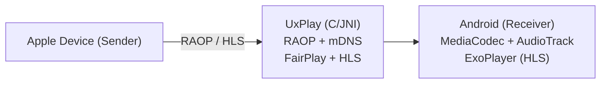

# FlowCast 技术说明 / Technical Notes

> 面向开发者的实现细节；用户向文档见 [README.md](../README.md)。
> 以下内容保留自上游发行版的技术说明，外链已改为指向本仓库内的文件；工程主页为 https://github.com/zwkit/FlowCast 。

## Audio/video sync

Mirroring used to anchor video to its own first decoded frame and audio to its own Oboe stream. Both sides were internally smooth, but the two clocks had no relationship: whatever cushion the audio pre-buffer built (tens to hundreds of milliseconds, and it moves as the adaptive cushion reacts to the link) showed up as lip-sync offset, and nothing ever corrected it.

The audio engine is now the master clock. When the pre-buffer finishes priming it publishes an anchor — the PTS of the first sample about to be played plus the `CLOCK_MONOTONIC` instant it plays at (`timeline_buffer.h` → `audio_engine_playout_anchor()` → JNI → `AudioRenderer.playoutAnchor()`). The video renderer maps every decoded frame through that anchor (`VideoRenderer.scheduledRenderNs`) and hands the resulting wall-clock deadline to `releaseOutputBuffer(index, timestampNs)`, so a picture lands on screen at the same instant its audio does. Every re-prime — stream start, flush, underrun recovery, resume — bumps an epoch; the renderer sees the new epoch and re-aligns, which also cancels drift accumulated since the last anchor. With no audio at all it falls back to self-anchoring.

Hardware decoders differ in how much latency they hide, so the mapping still leaves a residual offset on some TVs and boxes. **Settings → Display → A/V sync** nudges the picture against the audio clock in 50 ms steps, ±500 ms (negative advances the picture, positive delays it). Over ADB: `av_sync_offset_ms`, default `0`, applied live without restarting the server.

Frame scheduling has to be on for any of this to matter, which is why `scheduled_output_buffer_release` (Settings → Developer options → Aligned frame pacing) now defaults to on.

### When the sender goes quiet

The jitter buffer's depth is also the length of any audio *tail*: if the phone stops producing sound while 700 ms are queued, those 700 ms keep playing after the picture already changed, which is heard as sound continuing for a second after leaving an app. Two things keep that bounded:

- **Stale tail cut** (`TimelineBuffer::cutStaleTail`). When no packet has arrived for 250 ms and more than 400 ms of audio is still queued, the leftover is dropped down to a 120 ms restart cushion. Audio that arrives *before* the pause is stale by definition — it can never be played at its proper time again — so this is catching up rather than losing anything. A short leftover is left alone, so ordinary jitter (which the cushion exists to absorb) is never truncated.
- **The cushion tracks the link, not the clock** (`DelayTracker::observe`). The base latency used to creep up per packet, which made the measured delay converge to roughly the drift rate times ten seconds; a sender whose pts ran a couple of percent fast could inflate the cushion into the hundreds of ms — and that inflation *is* tail. It now follows sustained drift over a 2 s time constant, so drift costs a few ms while a jittery link still gets the cushion it needs.

Both are logged (`audio buffer settled: …`, `audio idle: …`, `audio tail cut: …`), so a tail report can be tied to a number instead of a guess. [`tools/timeline_tail_test.cpp`](../tools/timeline_tail_test.cpp) exercises the three cases on a device:

```bash
$NDK/toolchains/llvm/prebuilt/windows-x86_64/bin/clang++ --target=x86_64-linux-android24 \
    -std=c++17 -O1 -static-libstdc++ -I app/src/main/cpp tools/timeline_tail_test.cpp \
    -o /tmp/tail_test -llog
adb push /tmp/tail_test /data/local/tmp/ && adb shell "chmod 755 /data/local/tmp/tail_test; /data/local/tmp/tail_test"
```

## Configure from ADB

On devices without a display, settings can also be changed over ADB. The receiver is protected by `android.permission.DUMP` so regular installed apps cannot change them. Values are passed as text using `--es`. Using `adb shell`:

```bash
export KEY="server_name" VALUE="Speaker"
am broadcast -n io.github.zwkit.flowcast/io.github.jqssun.airplay.SettingsReceiver -a io.github.zwkit.flowcast.SET_SETTING --es key "$KEY" --es value "$VALUE"
```

To list all settings with their current values as JSON:

```bash
am start -n io.github.zwkit.flowcast/io.github.jqssun.airplay.MainActivity
am broadcast -n io.github.zwkit.flowcast/io.github.jqssun.airplay.SettingsReceiver -a io.github.zwkit.flowcast.LIST_SETTINGS
```

> The component class names still use the original `io.github.jqssun.airplay` namespace; only the application id changed to `io.github.zwkit.flowcast`, so `-n` needs the fully qualified class name.

## Implementation

This application uses the C-based [UxPlay](https://github.com/FDH2/UxPlay) library to implement the AirPlay/RAOP protocol, with a JNI bridge to the Android application layer. Audio can be decoded via MediaCodec or a software ALAC decoder, while mirroring video is decoded via MediaCodec and rendered to a SurfaceView. HLS sessions are served through a local playlist proxy.

When using USB tethering, the Android device can act as a reliable secondary display over a wired connection. Apple devices natively support USB tethering over CDC-NCM, so on Android devices that default to RNDIS, you may need to switch to CDC-NCM over ADB:

```bash
adb shell settings put global tether_force_usb_functions 1
```



CMake is used for native C/C++ components under [`app/src/main/cpp`](../app/src/main/cpp). **All native dependencies are vendored in-tree — no `git submodule` step is needed:**

- `third_party/UxPlay`（已应用 [`patches/UxPlay`](../app/src/main/cpp/patches/UxPlay) 的全部 9 个本地补丁）、`third_party/libplist`、`third_party/openssl-cmake`：随仓库分发的源码
- `third_party/ffmpeg-prebuild` / `third_party/openssl-prebuild`：三个 ABI（arm64-v8a / armeabi-v7a / x86_64）的预编译静态库，Windows 本地构建直接使用
- POSIX 源码构建：OpenSSL 走 `openssl-cmake`；FFmpeg 源码未纳入版本控制（约 105MB），如报错缺失，按 [`BuildFFmpeg.cmake`](../app/src/main/cpp/cmake/BuildFFmpeg.cmake) 的指引获取

```bash
./gradlew assembleDebug
```

预编译库的再构建脚本在 [`tools/`](../tools)（`ffmpeg_build_msys*.sh` / `openssl_build_msys*.sh`，需 MSYS2 + NDK 27）。如需对纯净上游 UxPlay 重新应用补丁：`pip install patch && python tools/apply_patches.py app/src/main/cpp/patches/UxPlay <uxplay_root>`。单元测试：`./gradlew :app:testDebugUnitTest`。

See [.github/workflows/apk.yml](../.github/workflows/apk.yml) for reproducible builds.

## Build & release notes

- Toolchain: JDK 21, Android SDK `compileSdk 37`, NDK `27.0.12077973`, `minSdk 24` / `targetSdk 37`.
- Release signing is configured in [`app/build.gradle.kts`](../app/build.gradle.kts): passwords come from `FLOWCAST_KEYSTORE_PASSWORD` / `FLOWCAST_KEY_PASSWORD` or `local.properties`. `local.properties`, `*.keystore`, `*.jks` are excluded by [`.gitignore`](../.gitignore) — never commit a keystore or its passwords.
- The two jars in [`app/libs/`](../app/libs) (`zxing-core-3.5.3.jar`, `media3-exoplayer-rtsp-1.11.1.jar`) are vendored as local file dependencies so the build works offline; the RTSP jar must stay in lockstep with the media3 version in [`gradle/libs.versions.toml`](../gradle/libs.versions.toml).
- CI (`apk.yml`) rebuilds the release APK/AAB on `v*.*.*` tags and publishes a GitHub Release. After moving to a new repository, re-create the `STORE` (base64 keystore) and `LOCAL` (base64 `local.properties`) secrets in the repository settings.
- UxPlay's 9 local patches are applied to the vendored source at setup time; the build deliberately has no git-dependent patch task so it works from a plain source archive.
